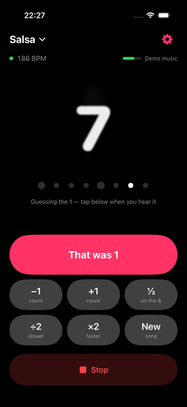
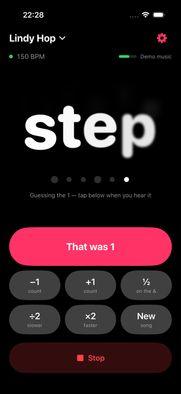
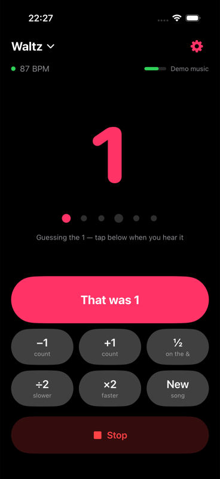
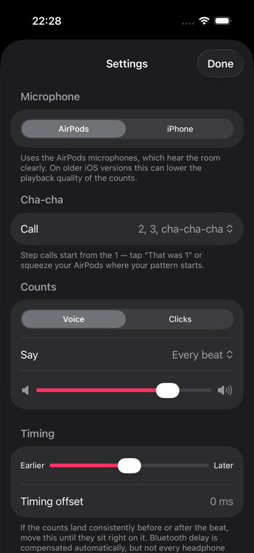
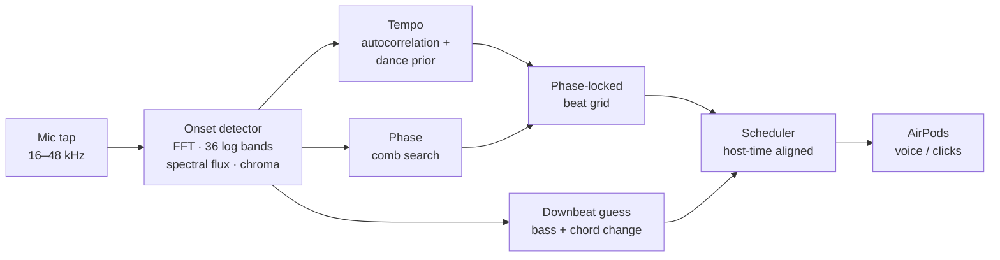

# Dance Count

**An iPhone app that listens to the music at a dance social and counts the beat into your AirPods**, so you can always find the 1. It speaks "one, two, three…" on the beat, or calls the footwork ("rock, step, tri-ple, step").

<p align="center">
  
  
  
  
</p>

All audio analysis runs on the phone in real time. Nothing is uploaded, and there are no third-party libraries: it uses only Swift, AVFoundation and Accelerate (vDSP).

## Features

- **16 dances.** Social: salsa, bachata, kizomba, West Coast Swing, Lindy Hop. Ballroom standard: waltz, Viennese waltz, tango, slow foxtrot, quickstep. Ballroom latin: cha-cha, samba, rumba, paso doble, jive. Each dance sets the tempo range to search (ballroom ranges come from competition tempos) and the meter (waltzes count in 3/4).
- **Step calls.** Lindy Hop "rock, step, tri-ple, step, tri-ple, step", West Coast Swing "walk, walk, triple, step, anchor, step", foxtrot "slow, quick, quick", cha-cha "two, three, cha-cha", and more. Salsa stays silent on 4 and 8; bachata says "tap".
- **Hands-free corrections.** Squeeze an AirPods stem on the 1. Double squeeze means new song; triple squeeze shifts half a beat. On screen: ±1 count, ½ beat, ×2/÷2 tempo.
- **Works locked in a pocket.** It runs as a background audio session. It can listen through the AirPods microphones (iOS 26 full-bandwidth and far-field modes where available) or the iPhone mic.
- **Latency compensation.** Counts are scheduled ahead on the audio clock, so after Bluetooth output delay they land on the beat in your ear. A manual offset covers headphones that misreport their latency.

## How it works



The core is [`BeatKit`](BeatKit/Sources/BeatKit), a platform-independent Swift package:

1. **Onset detection** ([`OnsetDetector`](BeatKit/Sources/BeatKit/OnsetDetector.swift)). A 46 ms Hann-windowed FFT every 10 ms, at any sample rate. Positive log-compressed spectral flux across 36 log-spaced bands, a separate low-band flux for kick drum and bass, and a 12-bin chroma for detecting chord changes.
2. **Tempo.** Autocorrelation of the onset envelope over 8 s, scored at the beat lag and twice the lag, with a log-normal prior centred on the chosen dance's typical tempo. The prior fixes most half- and double-speed errors. The tempo is then refined below one-frame resolution from the autocorrelation peaks at 1, 2 and 4 beat periods.
3. **Phase and grid.** A comb search over the last 4 s finds where the beats fall. A phase-locked loop maintains a beat grid that can be extrapolated into the future, because counts must be scheduled about 0.2 s ahead.
4. **When to count at all.** The tracker locks only when several successive tempo estimates agree *and* onsets line up sharply on the grid. This keeps crowd chatter from being counted. On its own, the tempo prior would turn noise into a "steady" tempo near the typical BPM.
5. **Where 1 is.** Each finished beat is scored for bass onsets plus chroma change across two-beat spans; chords tend to change on the 1. Scores accumulate per position in the count cycle. Overall loudness is deliberately excluded, because the loudest hit is usually the snare on 2 and 4. Salsa uses a known offset, since its bass and congas accent beat 4.

The app ([`AudioCore`](DanceCount/AudioCore.swift)) maps stream time to the host clock using the mic buffers' timestamps. It subtracts input latency, then schedules pre-rendered voice buffers on `AVAudioPlayerNode`s at `beat − output latency`.

## Debugging with real recordings

Synthetic tests only get you so far. The first field test on a real bachata song produced counts like "2, 2, 2". The app has a debug mode that saves what the mic heard, so I pulled the clip off the phone and replayed it through the same tracker on the Mac (`beatcli file clip.wav --style bachata`). That found three separate problems:

| Symptom | Cause | Fix |
|---|---|---|
| Count jumps after quiet passages | Tempo measured to whole 10 ms frames (130.4 vs 127.7 BPM). A 2 % error drifts a beat in about 20 s. | Sub-frame refinement from peaks at 1, 2 and 4 periods. A stiff loop that ignores tempo readings when the rhythm is weak *relative to the song's own strong parts*. |
| Flips between the beat and the "&" | In bachata the güira eighth notes (260 BPM) are a stronger pulse than the beat. The two halves are nearly equal over 4 s. | A half-beat flip now needs about 12 s of bass-weighted evidence, and never happens after the user set the beat. |
| Numbers shift a few seconds in | Counting started before the 1 had been guessed. | Neutral ticks until the 1 is known. |

An earlier on-device "crash" was actually a hang: `nextBeat(after: beat.time)` could return the same beat through floating-point rounding, so the scheduler spun forever. I found it by streaming `os_log` from the phone (`devicectl … --console`). A regression test now covers it.

## Testing

```bash
scripts/build.sh test    # unit tests (BeatKit)
scripts/build.sh bench   # accuracy table on synthetic music
```

[`SyntheticSong`](BeatKit/Sources/BeatKit/SyntheticMusic.swift) generates pop, salsa (son clave, tumbao bass anticipating the 1, montuno), bachata, swing and waltz grooves with known beat times. It can add tempo drift, timing jitter, reverb, crowd babble and a "phone in a trouser pocket" low-pass. [`Simulation`](BeatKit/Sources/BeatKit/Simulation.swift) replays audio exactly as the app does, committing each beat 0.35 s before it happens, and scores what the dancer would actually hear.

Selected results (F-measure with a ±70 ms window, mean timing error, and the share of beats in the right bar position after 12 s):

| Groove | Clean | Pocket + crowd + reverb |
|---|---|---|
| Pop 124 BPM | F 0.95, −2 ± 4 ms, bar 100 % | F 0.95, −2 ± 4 ms, bar 100 % |
| Salsa 200 BPM | F 0.95, −1 ± 5 ms, bar 100 % | F 0.77, +16 ± 17 ms, bar 87 % |
| Swing 180 BPM | F 0.93, −1 ± 8 ms, bar 100 % | F 0.95, +7 ± 8 ms, bar 100 % |
| Waltz 87 BPM (3/4) | F 0.95, −3 ± 4 ms, bar 100 % | F 0.95, −3 ± 6 ms, bar 100 % |
| Crowd chatter only | 0–24 false beats/min | 0–11 false beats/min |

F tops out near 0.95 because the first ~4 s of each song are spent listening.

## Known limitations

- Telling 1 from 5 is often musically ambiguous, and the automatic guess is weakest for salsa and bachata. One squeeze on the 1 per song fixes it for the rest of the song.
- A muffled phone in a pocket with salsa's off-beat-heavy montuno can lock onto the "&". In the benchmark, pocket salsa at 170 BPM does exactly that (F 0.00), and salsa at 200 BPM under a crowd louder than the music never locks. The ½ button (or a triple squeeze) corrects the off-beat case, and the correction sticks.
- Real-world tuning so far comes from a small number of recordings. The app saves the last minute of mic audio (Settings, then *Song it got wrong?*) to grow that set.

## Building

Requires Xcode 26.2+ (iOS 26.2 SDK) and [XcodeGen](https://github.com/yonaskolb/XcodeGen).

```bash
scripts/build.sh ios                      # simulator build
scripts/build.sh run-ios -demo salsa      # simulator with generated music fed to the tracker
scripts/build.sh install                  # release build onto a connected iPhone
```

To build for your own iPhone, set `DEVELOPMENT_TEAM` in `project.yml` to your own team ID.

## Layout

```
BeatKit/            Swift package: OnsetDetector, BeatTracker, DanceStyle, SyntheticSong, Simulation
  Sources/beatcli/  bench | debug | synth | file <audio> --out mixed.wav (counts mixed in, to listen)
DanceCount/         iOS app: AudioCore (session, engine, scheduler), CountModel, CountSounds, SwiftUI views
scripts/            build.sh, make-icon.swift
```
